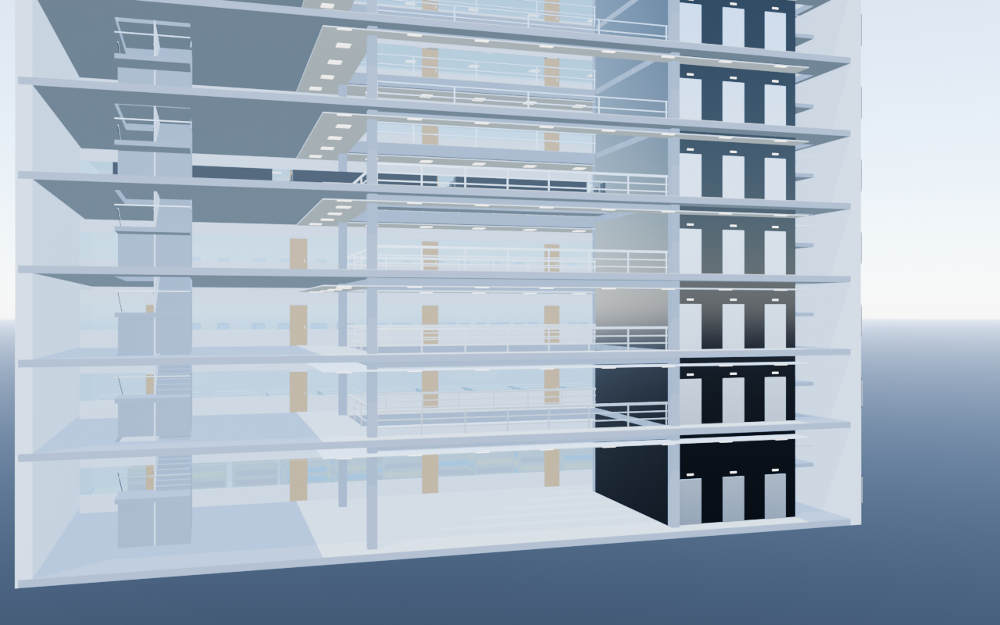
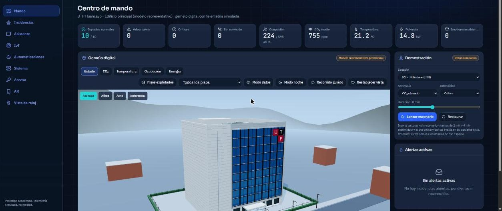
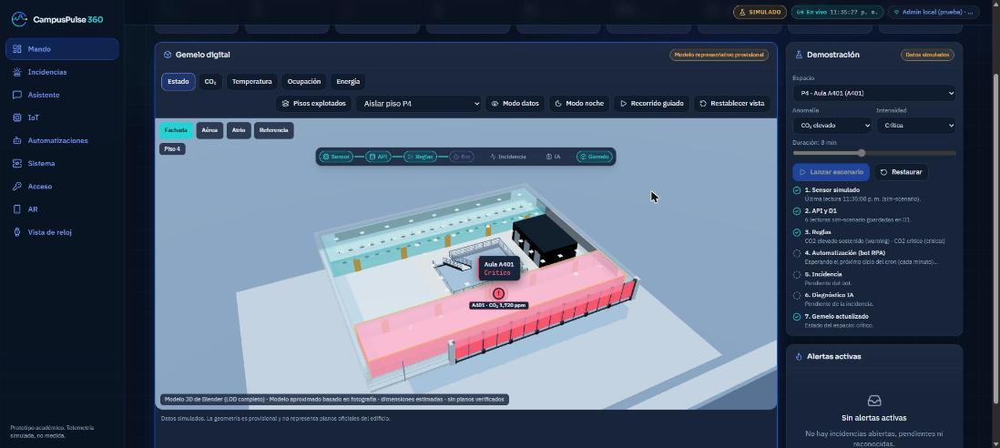
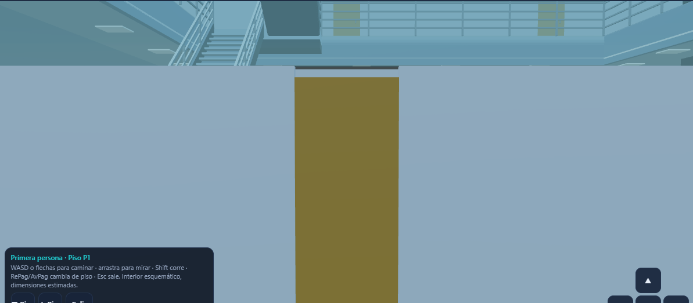
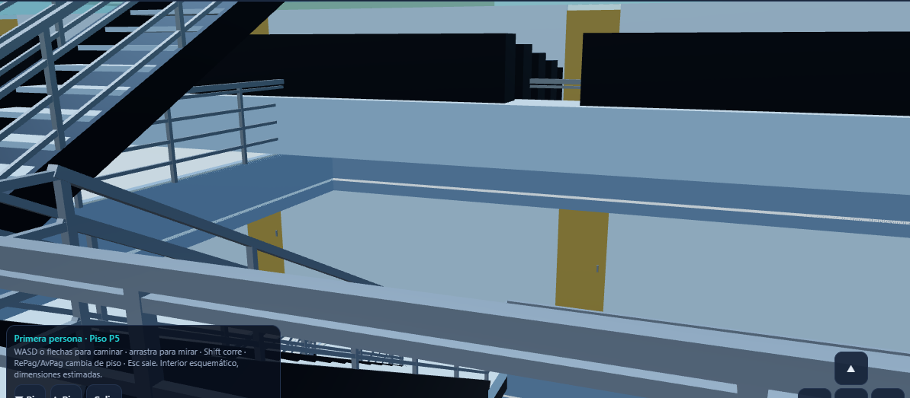
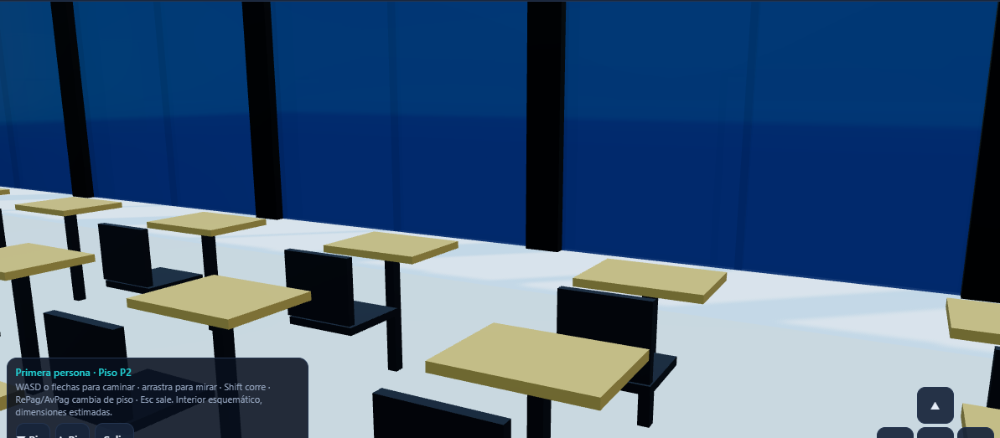
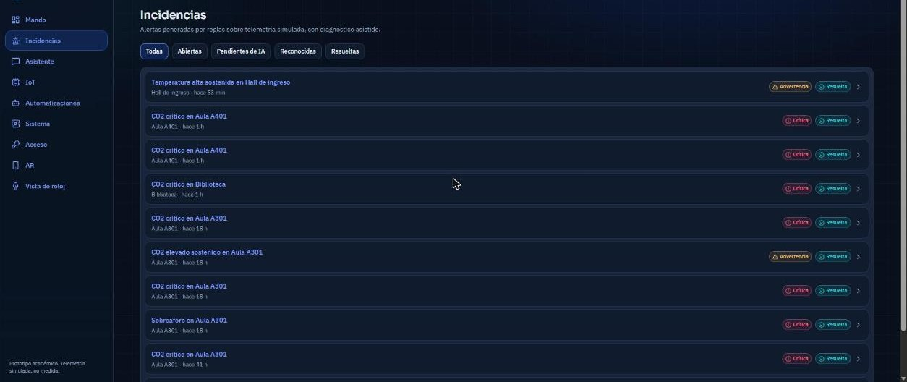
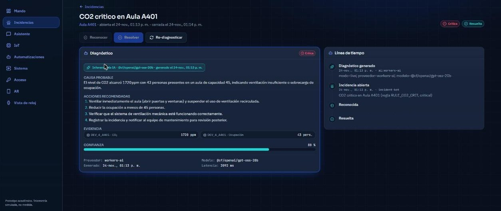
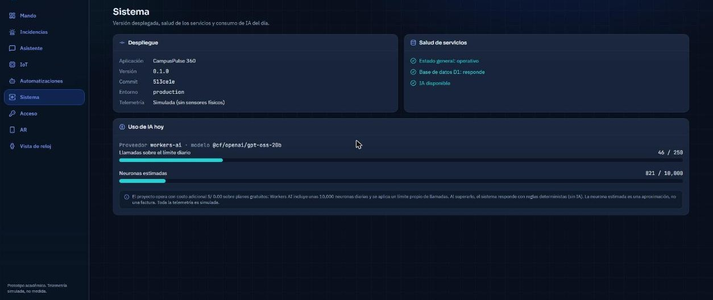

# CampusPulse 360

## Gemelo digital inteligente de la UTP Huancayo con IoT, automatización, IA generativa, DevOps y experiencia inmersiva web

**Informe técnico único — Proyecto Final (Unidad 5) y Tarea Académica N.° 5**

| Dato | Valor |
|---|---|
| Universidad | Universidad Tecnológica del Perú — sede Huancayo |
| Curso | **[COMPLETAR: nombre exacto del curso y sección]** |
| Docente | **[COMPLETAR]** |
| Grupo | **[COMPLETAR: número de grupo]** |
| Integrantes | **[COMPLETAR: apellidos y nombres, código y rol de cada integrante]** |
| Fecha de entrega | 27 de noviembre de 2026 |
| Demo pública | https://campuspulse.campuspulse-api.workers.dev |
| Repositorio | https://github.com/Jhosep20-code/CampusPulse360 (rama `feature/hito-2`, PR #1) |
| Versión en producción | Worker `d9180962` · commit `513ce1e` · D1 con migraciones 0001–0007 |

> **Declaraciones de honestidad:**
> - **Telemetría:** toda es **simulada**; no hay sensores físicos. La interfaz la rotula «SIMULADO».
> - **Modelo 3D:** es **representativo**. Las dimensiones están estimadas a partir de fotografías, sin planos.
> - **IA:** se usa **Cloudflare Workers AI con el modelo `@cf/openai/gpt-oss-20b`** (pesos abiertos publicados por OpenAI), **no la API oficial de OpenAI**.
> - **TA5:** se resuelve con una alternativa inmersiva **web**. Unity **no** se implementó (§8).
> - **Cifras:** todas proceden de ejecuciones reales registradas en `docs/evidencias/`. Las pruebas pendientes se indican como tales.

---

## Resumen ejecutivo
CampusPulse 360 es un gemelo digital de la sede UTP Huancayo, funcional y desplegado públicamente.

**La cadena completa, en producción:**
1. Diez sensores simulados envían CO₂, temperatura, humedad, ocupación y consumo eléctrico.
2. Una API en Cloudflare Workers valida y guarda las lecturas en D1.
3. Cada minuto, un bot (RPA) evalúa 7 reglas, abre y cierra incidencias y pide un diagnóstico a la IA (gpt-oss-20b).
4. El gemelo 3D de 10 pisos, modelado en Blender, cambia de color, ilumina la ventana del aula afectada y enfoca la cámara.

**Además:**
- un **asistente conversacional** que responde con datos reales del backend (rankings y porcentajes calculados de forma determinista);
- **realidad aumentada WebXR**;
- un **recorrido cinematográfico guiado** y un **recorrido en primera persona** por los 10 pisos;
- una **vista de reloj**;
- **acceso con passkeys**;
- **CI/CD** con GitHub Actions y Docker.

**Costo adicional: S/ 0,00** (planes gratuitos).

**Resultados verificados (24-nov-2026):**
- **Producción:** CI en verde en los tres últimos commits publicados.
- **Pruebas:** 349 unitarias y de integración y 15 e2e en verde.
- **Diagnóstico IA:** una incidencia crítica real de CO₂ en A401 se diagnosticó **en vivo en 2,09 s**.
- **Asistente:** respuestas contrastadas con los datos del backend.

**Pendiente de evidencia física:** AR en el Galaxy S25 Ultra y la vista en el Galaxy Watch6 Classic.

---

## 1. Introducción y problemática
La gestión de las condiciones de un campus universitario suele ser **reactiva y fragmentada**:
- las incidencias ambientales (aire viciado por CO₂, calor) y de aforo se detectan tarde y se reportan a mano;
- no existe una vista unificada del estado de cada aula, piso y servicio;
- no se anticipa la saturación de los espacios ni el deterioro de la calidad del aire;
- quienes deciden (operaciones, seguridad, docentes) no tienen una herramienta común para preguntar «¿qué está pasando?» y obtener una respuesta con datos.

**Relevancia actual:**
- La ventilación y el aforo de las aulas se convirtieron en criterios de salud y de calidad educativa.
- Los gemelos digitales, el IoT y la IA generativa ya son tecnologías accesibles, incluso con costo cero en la nube.

> **[COMPLETAR, opcional]:** si el equipo cuenta con datos reales de la sede (número de aulas, aforo total, incidencias reportadas), añádalos aquí **con su fuente**. No se incluyen estadísticas sin una fuente verificable.

## 2. Objetivos
**Objetivo general:** diseñar, implementar y desplegar públicamente un gemelo digital de la UTP Huancayo que monitoree el estado de los espacios, automatice la detección y el diagnóstico de incidencias y permita explorar el edificio en 3D, en AR y en primera persona.

| Objetivo específico | Meta | Resultado real (fuente) |
|---|---|---|
| **OE1 IoT:** recibir y visualizar telemetría | 10 dispositivos × 5 variables, lectura por minuto | **Cumplido:**<br>• 10 dispositivos × 5 variables en producción;<br>• ingesta con firma HMAC verificada (910/910 lecturas aceptadas);<br>• simulador en la nube cada minuto.<br>(hito-3; captura `produccion/06`) |
| **OE2 RPA:** detectar y gestionar incidencias sin intervención | Una incidencia por condición sostenida; cierre automático | **Cumplido:**<br>• bot cada minuto (`success`), 7 reglas, deduplicación y cierre tras 10 min normalizados (`cerradas=2`);<br>• incidencias en A301, A401, BIB y LOBBY.<br>(hito-3, hito-10; capturas `produccion/02` y `04`) |
| **OE3 IA:** diagnóstico y respuestas útiles con datos reales | JSON válido, causa, acciones y evidencia citada | **Cumplido:**<br>• diagnóstico de A401 en vivo en 2.092 ms, que cita 1.720 ppm y 43/45 personas;<br>• asistente con rankings verificados contra `/live`.<br>(hito-9, hito-10; capturas `produccion/03` y `07`) |
| **OE4 DevOps:** probar y construir automáticamente | Pipeline con pruebas, e2e en Docker y secretos | **Cumplido:**<br>• GitHub Actions en verde (gitleaks, tipos, pruebas, build, e2e con Docker Compose + Playwright, imagen del simulador);<br>• deploy con rollback.<br>(captura `produccion/10`) |
| **OE5 Experiencia:** 3D fluido, multidispositivo e inmersivo | ≥ 30 FPS en escritorio; móvil; AR | **Parcial:**<br>• 113 FPS de media en escritorio con GPU (hito-8);<br>• vista móvil verificada en navegador y e2e;<br>• **la AR física en el S25 Ultra está pendiente** |
| **OE6 Predicción:** pronóstico a 30 min | Holt con error medido | **Cumplido en pruebas:** Holt con backtest (MAE) sobre datos simulados (pruebas unitarias) |

## 3. Alcance y metodología
**Alcance:**
- un edificio (10 pisos);
- 10 espacios instrumentados en P1–P5: hall, biblioteca, 4 aulas, 2 laboratorios, auditorio y oficinas;
- P6–P10 modelados y rotulados «sin espacios instrumentados»;
- 7 reglas de alerta;
- un asistente de IA de solo lectura;
- tres niveles de AR;
- vista de reloj;
- recorridos guiado y en primera persona.

**Fuera de alcance:**
- sensores físicos;
- planos oficiales;
- VR con visor;
- Unity (ver §8);
- la API oficial de OpenAI.

**Metodología: iterativa por hitos, con verificación antes de declarar terminado cada módulo:**
- **Análisis de las rúbricas:** `docs/requisitos/`.
- **Decisiones registradas:** `docs/decisiones/ADR-001…005`.
- **Riesgos:** `docs/riesgos.md`.
- **Ciclo de cada hito:** diseño → implementación → pruebas automáticas → despliegue con respaldo → evidencias en `docs/evidencias/hito-1 … hito-10`.

**Herramientas de trabajo:** Git con PR #1 sobre `main` (sin fusión automática), CI en cada push, Docker Compose para el stack local y respaldo de D1 antes de cada migración.

## 4. Arquitectura de la solución
```
 FUENTES (todas source = sim)                   CLOUDFLARE (plan Free)                         CLIENTES
 ───────────────────────────                    ─────────────────────────────────────          ─────────────────────────
 Simulador IoT (Docker / nube) ──HTTPS+HMAC──►  Worker "campuspulse" (Hono, TypeScript)  ◄──►  Escritorio: Centro de mando
 Escenarios de demostración ──(admin)───────►   ├─ /api/v1/*  ──► D1 (SQLite)                  + gemelo 3D + primera persona
                                                ├─ Cron * * * * *: bot de incidencias          Móvil (S25 Ultra): /ar WebXR
                                                │    reglas → incidencia → IA → aviso          Reloj (Watch6): /reloj
                                                ├─ Cron 0 12 * * *: bot de reportes
                                                ├─ Workers AI: @cf/openai/gpt-oss-20b
                                                │    (respaldo determinista "sin IA")
                                                └─ Static Assets: SPA React + GLB (Blender)
 CI/CD: GitHub Actions → gitleaks → tipos/pruebas/build → e2e Docker Compose + Playwright → imagen GHCR → deploy (condicionado)
```

**Cadena de valor (cada paso es verificable en la interfaz, en la franja «Sensor → API → Reglas → Bot → Incidencia → IA → Gemelo»):**
```
Sensor simulado ─► API (HMAC, zod) ─► D1 (readings) ─► Reglas sostenidas (SQL) ─► Bot RPA (cron 1 min)
   ─► Incidencia (dedup) ─► Diagnóstico IA (JSON validado) ─► Gemelo 3D (color, baliza, ventana, cámara)
```

**Decisiones clave (ADR):**
- **Workers + D1 + Workers AI en el plan Free** (ADR-001).
- **Proveedor de IA intercambiable** (ADR-002): Workers AI, un adaptador para la API oficial de OpenAI que solo se activa con una clave propia, y un respaldo por reglas.
- **Passkeys sin contraseñas** (ADR-003).
- **Alternativa web para la TA5** (ADR-005).

**Monorepo pnpm:**

| Módulo | Contenido |
|---|---|
| `apps/api` | Hono, D1, bots, IA |
| `apps/web` | React 19, Three.js/R3F |
| `packages/contracts` | Contratos zod compartidos |
| `tools/simulator` | Simulador IoT y su imagen Docker |
| `tools/e2e` | Playwright |
| `assets/3d/blender` | Modelo reproducible por script |
| `infra/` | Docker Compose |

## 5. Tecnologías utilizadas y justificación
| Eje del curso | Tecnología | Justificación |
|---|---|---|
| IoT | Simulador TypeScript (perfiles por tipo de espacio y hora de Lima), ingesta HTTPS con HMAC-SHA256 y anti-replay de ±60 s | Protocolo compatible con un ESP32 real sin cambiar la API |
| RPA / bots | Cron Triggers de Workers: bot de incidencias por minuto y bot de reportes diario | Automatización sin servidores propios, con registro en `bot_runs` |
| IA generativa | Workers AI `@cf/openai/gpt-oss-20b`, prompts versionados y salidas JSON validadas con zod | Gratuito (10.000 neuronas/día), con function calling y razonamiento |
| CI/CD y contenedores | GitHub Actions y Docker (simulador, stack local, e2e con Docker Compose, imagen en GHCR) | Pruebas automáticas en cada push y entorno reproducible sin conexión |
| Inmersivas (AR/VR) | Blender 5.3 → GLB; Three.js / React Three Fiber; WebXR (AR); Scene Viewer; recorrido en primera persona | Multiplataforma sin instalación; mismo modelo en web, AR y primera persona |
| Interfaz | React 19, TypeScript, Tailwind, diseño accesible (identidad #080F1D / #17243A / #2962FF / #22D3D6 / #F0B95B) | Responsive de 360 a 1920 px, vista de reloj circular |
| Datos | Cloudflare D1 (SQLite): lecturas, incidencias, reglas, salidas de IA, auditoría | 100.000 escrituras/día gratis; consumo medido en torno al 21 % |
| Seguridad | Passkeys (WebAuthn), roles, CSRF, CSP/HSTS, rate limit, gitleaks | Sin contraseñas almacenadas ni registro público |

## 6. Implementación del sistema
### 6.1 IoT (simulado)
- **Dispositivos:** 10 (`DEV_<piso>_<código>`), uno por espacio, con 5 variables: `co2_ppm`, `temp_c`, `rh_pct`, `occupancy` y `power_w`.
- **Simulador:**
  - curvas diarias de ocupación por tipo de espacio;
  - CO₂ por balance de masa sencillo, temperatura dependiente de la ocupación y la hora, y ruido;
  - modos `live`, `backfill` y `scenario`;
  - imagen Docker publicada por CI.
- **Ingesta:** `POST /api/v1/ingest` en lotes firmados (HMAC por gateway, ventana de ±60 s y claves revocables). En producción, un simulador en la nube mantiene la demo viva y se detiene cuando llega un gateway real.
- **Escenarios de demostración** (solo administradores), en cualquiera de los 10 espacios:
  - tipos: CO₂, temperatura, sobreaforo, consumo y **sin conexión**;
  - intensidad: advertencia o crítica;
  - insertan una rampa de lecturas `sim-scenario`;
  - «Restaurar» cierra solo las incidencias de ese espacio.

### 6.2 API y datos
- **API:** Hono en Workers, `/api/v1`, errores RFC 7807 y validación zod con contratos compartidos con el frontend.
- **D1** (migraciones 0001–0007, todas aditivas):
  - estructura: `spaces`, `devices`, `readings`;
  - reglas e incidencias: `alert_rules`, `incidents`, `incident_events`;
  - automatización e IA: `ai_outputs`, `bot_runs`, `reports`;
  - acceso y control: `users`, `passkeys`, `audit_log`, `scenario_overrides`.
- **Estado en vivo:** `/live` entrega el estado de cada espacio. El frontend lo consulta cada 10 s (con ETag) y se pausa con la pestaña oculta.

### 6.3 Reglas y RPA
**Reglas activas (7):**
- **CO₂:** ≥ 1.200 ppm durante 120 s (advertencia) y ≥ 1.500 ppm durante 60 s (crítica).
- **Temperatura:** ≥ 28 °C durante 180 s (advertencia) y ≥ 30 °C durante 60 s (crítica).
- **Sobreaforo:** ≥ 100 % durante 60 s (crítica).
- **Consumo:** ≥ 4.500 W durante 120 s (advertencia) y ≥ 6.000 W durante 60 s (crítica).

**Bot de incidencias** (cron cada minuto; captura `produccion/04`):
1. Detecta en SQL las condiciones sostenidas.
2. Abre una sola incidencia por espacio y regla (`dedup_key`); la regla crítica suprime la de advertencia de la misma métrica.
3. Diagnostica como máximo una incidencia por ciclo.
4. Cierra automáticamente las que llevan 10 min normalizadas.
5. Registra cada ejecución en `bot_runs` (por ejemplo, «reglas=7; nuevas=0»).

**Bot de reportes:** diario a las 07:00 (hora de Perú), con rollups y resumen.

**Corrección del 24-nov:** el gemelo marcaba «crítico» a 31,2 °C, pero solo existía la regla de advertencia. Se añadió `RULE_TEMP_CRIT` (migración 0007), con una prueba de coherencia que recorre los 4 tipos × 2 intensidades en 3 espacios.

### 6.4 IA generativa y prompt engineering
- **Tarea clave: diagnóstico de incidencias** (prompt `diagnose@1.0.0`):
  - **Rol:** operador de facilities.
  - **Contexto inyectado:** lecturas de los últimos 30 min, la regla, el aforo y el historial.
  - **Ejemplos:** 2 few-shot.
  - **Salida JSON:** `{causa_probable, severidad, acciones[], evidencia[{device_id, metric, valor}], confianza}`, validada con zod y con un reintento.
  - **Regla:** «si el dato no está en el contexto, decir que no se sabe».
  - **Ejemplo real en producción** (captura `produccion/03`): CO₂ crítico en A401. Causa «El nivel de CO₂ alcanzó 1720 ppm con 43 personas presentes en un aula de capacidad 45…», 4 acciones, evidencia citada, confianza del 80 %, `workers-ai · @cf/openai/gpt-oss-20b`, 2.092 ms.
- **Asistente conversacional** (prompt `assistant@1.1.0`):
  - **Herramientas de solo lectura** (nunca SQL libre): estado del campus, estado de un espacio, ranking por métrica, espacios por condición, incidencias, actividad del bot, diagnósticos de IA y pronóstico.
  - **Familias conocidas:** para 18 familias de preguntas, el backend elige la herramienta y calcula rankings y porcentajes. La IA solo redacta.
  - **Validación de fidelidad:** si la redacción omite el espacio o la cifra calculada, se descarta y se responde con el resultado verificado, rotulado `fallback`.
  - **Origen del rediseño:** corrige un defecto real («el espacio más ocupado respecto a su aforo» respondía «no hay»; hito-9).
- **Cuota y respaldo:**
  - límite propio de 250 llamadas/día y contador visible en «Sistema» (46/250 llamadas y 821/10.000 neuronas el 24-nov; captura `produccion/05`);
  - sin cupo o sin red, el sistema responde con reglas deterministas rotuladas «sin IA».
- **Proveedor:**
  - `gpt-oss-20b` es un modelo de pesos abiertos de OpenAI servido por Cloudflare. **No es la API oficial de OpenAI**, que no tiene cuota gratuita.
  - Existe un adaptador para la API oficial (probado con mocks) que **no está activado**.
  - **Riesgo de interpretación:** la rúbrica dice «con APIs de OpenAI». Un evaluador estricto podría considerarlo un cumplimiento parcial (§11).

### 6.5 CI/CD y contenedores
**Workflow `.github/workflows/ci.yml`** (captura `produccion/10`):
1. Escaneo de secretos (gitleaks).
2. Tipos, pruebas y build.
3. e2e con Docker Compose + Playwright (Worker, D1 local y simulador en contenedores).
4. Imagen Docker del simulador en GHCR.
5. Deploy a Cloudflare, condicionado a `main` y a `DEPLOY_ENABLED` (desactivado a propósito).

**Ejecuciones en verde:** `513ce1e` (7 min 9 s), `72a68a2` y `e682243` (en el 2.º intento).

**Despliegue a producción**, manual y controlado:
1. Respaldo de D1: exportación con SHA-256 y marcador de Time Travel.
2. Auditoría y ensayo de cada migración sobre una copia del respaldo.
3. `wrangler deploy` desde el commit aprobado en CI.
4. Rollback documentado (`wrangler rollback 207d3808…`).

**Docker local:** `docker compose up` levanta el stack completo sin internet (modo de contingencia para la feria).

## 7. Gemelo digital e inmersión web
### 7.1 Modelo arquitectónico (Blender 5.3)
- **Script reproducible:** `assets/3d/blender/build_utp_huancayo.py`.
  - Jerarquía `BUILDING / FACADE / ROOF / ATRIUM / STAIRS / ELEVATORS / FLOOR_P01–P10 / SPC_* / SENSOR_ANCHORS`.
  - Materiales PBR (vidrio de muro cortina, paneles, madera, acero, losas).
  - Exporta GLB de escritorio, móvil y AR.
- **Edificio:**
  - **Fachada:** paño blanco, muro cortina azul de 7 franjas y marca UTP iluminada de noche.
  - **Interior:** atrio con escaleras en zigzag y barandas, núcleo de 3 ascensores, aulas con mobiliario, laboratorios y biblioteca.
- **Fidelidad:** contrastada con fotografías y videos oficiales (`docs/referencias/matriz-correspondencia-v3.md`). Las dimensiones son **estimadas**.




### 7.2 Visor 3D (Three.js / React Three Fiber)
- **Vistas:** Fachada, Aérea, Atrio (corte de sección), Referencia (comparación con una foto local que no sale del dispositivo), aislar P1–P10, pisos explotados, modo datos y modo noche.
- **Capas de datos:** estado, CO₂, temperatura, ocupación y energía.
- **Alertas visibles:**
  - transición de color del volumen del espacio;
  - pulso en crítico;
  - baliza con el valor («A401 · CO₂ 1.720 ppm»);
  - **ventana de la fachada iluminada** (dorada en advertencia, roja pulsante en crítico);
  - enfoque y órbita de cámara;
  - vuelta automática al estado normal al restaurar (hito-8; capturas `demo-animada/00–02`).
- **Rendimiento con GPU** (hito-8):
  - Fachada: 43 draw calls; piso aislado: 28.
  - **113 FPS de media** durante el recorrido y **117 FPS** en reposo.
  - Perfil móvil con LOD reducido y `prefers-reduced-motion` respetado.





### 7.3 Recorrido cinematográfico guiado
**Pasos:** aérea → fachada → atrio → piso → aula con sensores.

**Comportamiento:**
- movimiento continuo de cámara (órbita y transiciones de 1,1 s);
- **pausa**, **reinicio** y **cancelación** al arrastrar la cámara o con «Salir»;
- indicador ilustrativo del ascensor en el Atrio. Es «sin cabina modelada»: el GLB no tiene cabinas.

**Verificado en producción el 24-nov (hito-10):**
- pausa mantenida 9 s en el paso 5;
- reinicio al paso 1;
- cancelación por arrastre y con el botón.

**Grabación real:** 55 s (`capturas/video/demo-animada-local.webm`), con el 87 % de las muestras en movimiento.

### 7.4 Recorrido en primera persona (FPS) — nuevo para la TA5
Botón **«Primera persona»** en el Centro de mando (`apps/web/src/twin/fps.ts`, `CampusTwin.tsx`).

**Controles:**
- **WASD o flechas** para caminar y **Shift** para correr;
- **arrastrar con el ratón o el dedo** para mirar;
- **cruceta táctil** en el móvil;
- **RePag/AvPag** o botones para subir o bajar de piso (P1–P10), y **Esc** para salir.

**Cámara:** a 1,65 m sobre la losa.

**Colisiones simples** en planta, con las mismas medidas con las que Blender construye el GLB:
- muros exteriores;
- vacío del atrio desde P2;
- escaleras;
- núcleo de ascensores;
- tabiques de aulas y oficinas, con sus 5 puertas como único paso.

El mobiliario no colisiona (simplificación declarada).

**Sin geometría ni dependencias nuevas.** Al salir vuelven las cámaras orbitales; el modo cancela el recorrido guiado.

**Verificación (24-nov, local con el GLB):**
- 7 pruebas unitarias de colisiones;
- en la app, caminando con W desde el hall se cruza la puerta central y el atrio de P1 hasta el muro posterior;
- a 3,6 m de la puerta, el tabique detiene el avance a 0,35 m;
- el cambio de piso P1→P10 se detiene en P10;
- Esc devuelve la vista Fachada.

**Pendiente:** medir los FPS en un equipo con la ventana visible y en el S25. La pestaña de pruebas estaba en segundo plano y Chrome la limitaba a 1,5 FPS, lo que no representa el rendimiento real.





### 7.5 Realidad aumentada y reloj
- **AR (`/ar`), en tres niveles:**
  - **A:** WebXR `immersive-ar` con hit-test, maqueta de unos 0,60 m y colores en vivo;
  - **B:** Scene Viewer de ARCore con el GLB de AR (estático);
  - **C:** vista 3D, que **no es AR**.
  - En escritorio la página indica correctamente que no hay WebXR (captura `produccion/08`). **La prueba en el Galaxy S25 Ultra está pendiente.**
- **Reloj (`/reloj`):** esfera circular con la alerta más grave, KPIs y la etiqueta SIMULADO (captura `produccion/09`). Simulada en el navegador; **la prueba en el Galaxy Watch6 Classic está pendiente**.
- **Notificaciones al reloj:** Telegram **no está configurado**, porque falta el token del bot.

## 8. Adaptación técnica de la TA5: alternativa inmersiva web
### 8.1 Qué pide la TA5 y qué se entrega
- **Lo que pide:**
  - un proyecto 3D en **Unity** con terreno, objetos, materiales, duplicación y cámara FPS;
  - un proyecto VR en **Unity** con **Meta XR SDK, OpenXR y XR Plug-in Management**, ejecutado en un **simulador VR**.
- **Lo que entrega el equipo** (decisión ADR-005): la misma experiencia de diseño 3D y recorrido en primera persona, sobre **web**:
  - escenario modelado en **Blender 5.3**;
  - visor **Three.js / React Three Fiber**;
  - recorrido FPS web;
  - inmersión con **WebXR (AR)**.

### 8.2 Comparación Unity/VR frente a la alternativa web
| Aspecto | Unity + XR (lo que pide la consigna) | CampusPulse 360 web (lo entregado) |
|---|---|---|
| Herramientas y arquitectura | Editor Unity, C#, escenas y prefabs; Meta XR SDK, OpenXR, XR Plug-in Management; build por plataforma | Blender (modelo por script) → GLB → Three.js/R3F en React; un solo build web servido desde Cloudflare |
| Navegación e interacción 3D | CharacterController + Input System; XR Origin con locomoción | Cámara FPS propia (WASD, ratón o dedo, cruceta táctil, cambio de piso), colisiones en planta; además, cámaras orbitales, recorrido guiado y aislamiento de pisos |
| Compatibilidad | Ejecutable por plataforma (Windows, Android o visor); instalación previa | Navegadores con WebGL 2 (probado en Chrome/Brave de escritorio y vista móvil emulada; iOS **no probado**); sin instalación; enlace público |
| Integración con IoT e IA | Requiere programar clientes HTTP o WebSocket hacia la API | Nativa: el mismo gemelo muestra `/live`, incidencias, diagnósticos de IA y el asistente (que mueve la cámara a los espacios citados) |
| Realidad aumentada | AR Foundation / ARCore (otro proyecto) | WebXR `immersive-ar` (nivel A), Scene Viewer (B) y respaldo 3D (C) en la misma app |
| Requisitos de hardware | PC con GPU para el editor; visor para VR real (o simulador) | Navegador con WebGL 2; 113 FPS medidos en la laptop del equipo con GPU (hito-8); el móvil usa un LOD reducido (FPS en el S25 pendientes) |
| Escalabilidad | Un build por plataforma; distribución por tienda o archivo | Despliegue global en el borde (Cloudflare), actualizaciones instantáneas y CI/CD |
| Limitaciones | Curva de aprendizaje y licencias; integración de datos manual | **Sin VR con visor ni simulador VR de Unity**; colisiones simplificadas (sin mobiliario); interior esquemático |

### 8.3 Equivalencias y no cumplimientos literales
- **Funcionalmente equivalente:**
  - escenario 3D estructurado y ambientado con materiales PBR, duplicación de elementos (aulas, mobiliario, ventanas y barandas instanciadas) y entorno (terreno, calles y edificios vecinos);
  - recorrido en primera persona con control total del desplazamiento y colisiones;
  - navegación inmersiva interactiva;
  - documentación y código organizados.
- **No cumple literalmente:**
  - **no** se creó un proyecto en Unity;
  - **no** se instalaron Meta XR SDK, OpenXR ni XR Plug-in Management;
  - **no** se ejecutó un simulador VR de Unity;
  - **no** hay VR con visor.
  - La inmersión entregada es **AR WebXR** y **primera persona en pantalla**.
- **Riesgo:** los criterios 4, 5 y 6 de la TA5 (y «en Unity» de los criterios 1 a 3) dependen de que el docente acepte la alternativa. Se recomienda consultarlo **antes** de la entrega.

### 8.4 Camino futuro hacia Unity/OpenXR
- **Modelo reutilizable:** el GLB (`apps/web/public/models/`) es estándar y conserva la jerarquía `FLOOR_Pxx/SPC_*`, así que puede importarse en Unity con **glTFast**.
- **Pasos:**
  1. Añadir XR Origin con OpenXR y XR Interaction Toolkit.
  2. Reutilizar las colisiones como `BoxCollider` (las mismas medidas de `fps.ts`).
  3. Conectar `/api/v1/live` para colorear los espacios.
- **Material de partida:** la rama local `feature/ta5-unity` conserva un paquete C# de partida, **sin compilar ni probar**.

## 9. Pruebas funcionales, resultados y evidencias
| Tipo | Resultado (fecha) | Dónde |
|---|---|---|
| Unitarias e integración | **349 en verde** (24-nov): contratos 9, API 139 (incluye 46 de regresión del asistente y la coherencia de severidades), web 191 (incluye 7 de primera persona), simulador 10 | `pnpm -r test` |
| e2e (Playwright + Docker Compose) | **15 aprobadas y 3 omitidas a propósito** (5,2 min, local) y en verde en CI | `tools/e2e` y Actions |
| CI en GitHub | En verde en `513ce1e`, `72a68a2` y `e682243` | Actions |
| Secretos | gitleaks sin hallazgos en el historial de la rama | CI y local |
| Producción | `/system/health` ok; bot cada minuto en `success`; IA disponible | Captura `produccion/05` |
| Asistente con el modelo real | 12 preguntas en local y 8 en producción, comparadas con `/live`: ranking por porcentaje, número absoluto, CO₂, temperatura, consumo, sobreaforo, desconectados, incidencias y estado general | hito-9, hito-10 |
| Cadena completa | Escenario → reglas → bot → incidencia → diagnóstico en vivo → gemelo, en A301, A401, BIB y LOBBY | Capturas `produccion/02` y `03`; hito-3, hito-8 y hito-10 |
| Recorrido guiado, vistas y P1–P10 | Aprobado en producción (24-nov) | hito-10 §5 |
| Primera persona | Aprobado en local con el GLB (24-nov) | §7.4 y `capturas/primera-persona` |
| AR física y reloj físico | **Pendiente** | — |








## 10. Seguridad, autenticación y costos
- **Autenticación:**
  - passkeys (WebAuthn), con firma ECDSA y sin contraseñas almacenadas;
  - alta solo con un token de arranque de un solo uso, que ya fue consumido;
  - vinculación de un segundo dispositivo con un código de un solo uso válido 10 min;
  - sesión en cookie httpOnly/Secure/SameSite=Strict de 8 h.
  - **En producción:** 1 administrador con 2 passkeys (escritorio y Android).
- **Autorización y defensas:**
  - roles (visitante de solo lectura, operador y administrador);
  - CSRF por Origin y rate limit en D1;
  - HMAC en la ingesta;
  - CSP estricta, HSTS, `frame-ancestors 'none'` y `nosniff`;
  - registro de auditoría de las escrituras.
- **Secretos:** solo en `wrangler secret` y en GitHub Secrets; gitleaks en CI. Los respaldos de D1 quedan fuera de git (`backups/`).
- **IA:** herramientas de solo lectura, sin SQL libre, contexto delimitado y sin datos personales en los prompts.
- **Privacidad:** solo conteos agregados, sin cámaras ni identidades (minimización conforme a la Ley 29733).
- **Costos: S/ 0,00.**
  - Workers, D1 y Workers AI en el plan Free, sin facturación.
  - Consumo medido: unas 21.000 escrituras D1/día (21 % del límite) y 821 de 10.000 neuronas el 24-nov.
  - Al agotarse la cuota de IA, el sistema responde con reglas rotuladas.

## 11. Matriz de cumplimiento
**Leyenda:** ✅ cumplido con evidencia · 🟡 parcial o con riesgo · ⏳ pendiente · ❌ no cumplido.

### 11.1 Proyecto Final (20 puntos)
| # | Criterio (máx.) | Función verificable | Prueba / evidencia | Sección del informe | Estado |
|---|---|---|---|---|---|
| 1 | Planteamiento del problema y objetivo (2) | Problema, objetivos medibles y resultados reales | Tabla de OE con fuentes | §1–2 | ✅ (falta contexto local con fuente, opcional) |
| 2 | Aplicación de tecnologías del curso (3) | Los 5 ejes encadenados: IoT → D1 → RPA → IA → gemelo/AR, más CI/CD | Cadena verificada en producción en 4 espacios | §4–7, §9 | ✅ |
| 3 | Desarrollo técnico del prototipo (3) | Monorepo modular, contratos compartidos, 7 migraciones, bots y escenarios | 349 pruebas, 15 e2e y producción operativa | §6, §9 | ✅ |
| 4 | CI/CD y contenedores (3) | Actions: gitleaks, pruebas, e2e Docker, imagen GHCR; deploy con respaldo y rollback | Runs en verde y captura `produccion/10` | §6.5 | ✅ (deploy por CI desactivado a propósito; se hace manual y controlado) |
| 5 | IA y prompt engineering (3) | Diagnóstico JSON (tarea clave), asistente con herramientas y validación de fidelidad | Diagnóstico de A401 en vivo; 20 preguntas verificadas | §6.4 | 🟡 Cumple técnicamente; **riesgo:** Workers AI con un modelo de OpenAI, no la API oficial de OpenAI |
| 6 | Interfaz Web/AR/VR (1,5) | SPA responsive, gemelo 3D en tiempo real, primera persona, AR de 3 niveles y reloj | Capturas de producción; 113 FPS | §7 | 🟡 hasta probar la AR en el S25 |
| 7 | Informe técnico (1,5) | Este informe: esquemas, capturas, resultados e impacto | — | Todo | 🟡 faltan los datos académicos y las conclusiones finales |
| 8 | Presentación final (1,5) | Guion de 5 min con roles | `GUION_DEMO_5MIN.md` | §15 | ⏳ ensayo y **video** pendientes |
| 9 | Creatividad e innovación (1,5) | Gemelo conversacional (la IA mueve la cámara), alertas en la fachada, recorrido guiado y FPS, passkeys y simulación de escenarios | Capturas y video | §7, §13 | ✅ |

**Entregables del ZIP `PROFINAL_U5_GRUPO_#`:**

| Entregable | Estado |
|---|---|
| Propuesta inicial | **[CONFIRMAR si ya se entregó]** |
| Informe | Este documento, en Word y PDF |
| Video de máx. 5 min | **Pendiente de grabar** (guion listo) |
| Código | Repositorio y ZIP del código |
| Presentación | **Pendiente de ensayar** |

### 11.2 TA5 (20 puntos, 10 criterios × 2)
| # | Criterio | Función verificable en la alternativa web | Evidencia | Sección | Estado |
|---|---|---|---|---|---|
| 1 | Diseñar el escenario 3D **en Unity** | Escenario completo de 10 pisos en Blender: terreno, calles, edificios vecinos, interior y mobiliario | Renders y capturas del GLB | §7.1, §8 | 🟡 Equivalente en Blender/Three.js; **no es Unity** |
| 2 | Aplicar materiales y objetos 3D | Materiales PBR en todos los objetos; elementos duplicados e instanciados | Renders `blender/`, `glb/` | §7.1 | ✅ funcional (herramienta distinta) |
| 3 | Configurar recorrido tipo FPS | Primera persona: WASD, ratón o dedo, correr, cambio de piso, colisiones | 7 pruebas y 3 capturas | §7.4 | ✅ funcional en web (**no en Unity**) |
| 4 | Implementar el entorno VR **en Unity** | — (la inmersión es AR WebXR + FPS en pantalla) | — | §8.3 | ❌ no literal |
| 5 | Instalar y utilizar los plugins **de Unity** | Equivalentes web: WebXR Device API, Three.js/R3F, drei | — | §8.2 | ❌ no literal |
| 6 | Ejecutar y navegar el recorrido **VR** | FPS navegable en pantalla; AR en el móvil (pendiente de prueba física) | Capturas FPS | §7.4–7.5 | ❌ no literal (sin simulador ni visor VR) |
| 7 | Elaborar el informe técnico | Este informe único | — | Todo | 🟡 datos del grupo pendientes |
| 8 | Incluir capturas y evidencias | Capturas organizadas en `capturas/` (producción, primera persona, Blender, GLB, demo) | Inventario | §9, Anexo A | ✅ (faltan las del S25 y el Watch6) |
| 9 | Mantener código limpio y organizado | Monorepo con módulos, contratos, pruebas y nombres claros | Repositorio | §4 | ✅ |
| 10 | Redactar con claridad y precisión | Lenguaje técnico y honestidad declarada | — | Todo | ✅ (revisión final del equipo) |

## 12. Limitaciones
1. **Telemetría simulada:** no hay sensores físicos. El protocolo es compatible con un ESP32, pero no se ha probado con hardware.
2. **IA:** no se usa la API oficial de OpenAI. `gpt-oss-20b` en Workers AI está limitado por la cuota diaria; hay un respaldo determinista rotulado.
3. **Modelo 3D aproximado:** sin planos. El interior es esquemático y las cabinas de ascensor no están modeladas.
4. **TA5 sin Unity ni VR con visor:** la inmersión es AR WebXR y primera persona en pantalla.
5. **Pruebas físicas pendientes:** AR en el S25 Ultra, la vista en el Watch6 y la medición de FPS en el móvil. Telegram no está configurado.
6. **Primera persona:** colisiones en planta sin mobiliario y cambio de piso por botón (no se suben las escaleras).
7. **Despliegue:** el despliegue automático desde CI está desactivado a propósito; se hace manual, con respaldo y rollback.

## 13. Escalabilidad, impacto y trabajo futuro
- **Escalabilidad:**
  - la arquitectura en el borde escala sin servidores;
  - con 10 dispositivos a 1 lectura/min se usa el ~21 % de las escrituras gratuitas de D1;
  - para unos 20–30 espacios bastaría el plan Free; más allá habría que muestrear o agregar.
  - Los contratos zod y el patrón `SPC_<piso>_<código>` permiten añadir espacios con migraciones aditivas.
- **Impacto esperado:**
  - detección automática de condiciones de riesgo (CO₂, calor, aforo, consumo) en 1–2 ciclos del bot desde la lectura sostenida, con diagnóstico explicable y acciones;
  - visión unificada del campus por piso y espacio;
  - consultas en lenguaje natural con respuestas verificables;
  - todo con costo de operación de S/ 0,00.
- **Trabajo futuro:**
  1. Sensores reales (ESP32 + NDIR CO₂) por el mismo protocolo HMAC.
  2. Telegram y notificaciones al reloj.
  3. Recintos y núcleo con croquis del equipo.
  4. Unity/OpenXR a partir del GLB (§8.4).
  5. WebXR `immersive-vr` con visor.
  6. Evaluación formal del asistente con `apps/api/eval` (conjunto de preguntas ya preparado).

## 14. Conclusiones
> **[COMPLETAR por el equipo tras la sustentación].** Propuesta de base, ajustada a lo verificado:

1. CampusPulse 360 integra los cinco ejes del curso en una **cadena funcional y pública**, comprobada en producción con incidencias reales en cuatro espacios distintos:
   - IoT simulado;
   - automatización RPA;
   - IA generativa;
   - CI/CD con contenedores;
   - interfaces inmersivas.
2. **La IA aporta valor cuando trabaja sobre datos calculados por el backend.** La corrección del asistente demostró que los cálculos deterministas y la validación de fidelidad evitan respuestas incorrectas sin renunciar a la redacción natural del modelo.
3. **La alternativa web cubre de forma funcional** el diseño 3D y el recorrido en primera persona de la TA5, con ventajas de acceso y de integración de datos. No sustituye literalmente a Unity ni a la VR con visor, y así se declara.
4. **[COMPLETAR: aprendizajes del equipo y resultado de la demostración].**

## 15. Presentación y video
- **Guion definitivo de máximo 5 minutos:** [`GUION_DEMO_5MIN.md`](GUION_DEMO_5MIN.md).
- **Inventario de evidencias:** [`INVENTARIO_EVIDENCIAS.md`](INVENTARIO_EVIDENCIAS.md).

## 16. Referencias
- Cloudflare. *Workers, D1 y Workers AI — Platform limits and pricing.* developers.cloudflare.com (consultado el 21-nov-2026).
- OpenAI. *gpt-oss-20b* (modelo de pesos abiertos), servido mediante Cloudflare Workers AI (`@cf/openai/gpt-oss-20b`).
- W3C. *WebXR Device API* y *WebAuthn Level 2*.
- Three.js / pmndrs. *React Three Fiber* y *drei*. threejs.org, docs.pmnd.rs.
- Blender Foundation. *Blender 5.3 Manual.*
- Google. *ARCore supported devices* y *Scene Viewer.* developers.google.com/ar.
- GitHub. *GitHub Actions documentation.*
- Unity Technologies. *XR Interaction Toolkit* y *OpenXR Plugin* (referencia para la comparación del §8).
- Congreso de la República del Perú. *Ley N.° 29733, Ley de Protección de Datos Personales.*

## Anexo A. Evidencias
- **Por hito:** `docs/evidencias/hito-1.md` … `hito-10-despliegue-asistente.md`.
- **Decisiones:** `docs/decisiones/ADR-001…005`.
- **Inventario de capturas** y qué demuestra cada una: [`INVENTARIO_EVIDENCIAS.md`](INVENTARIO_EVIDENCIAS.md).
