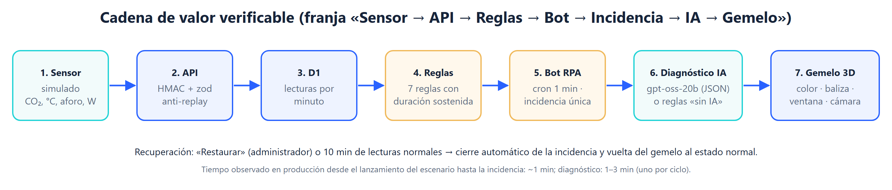
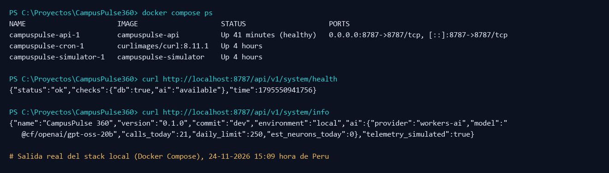
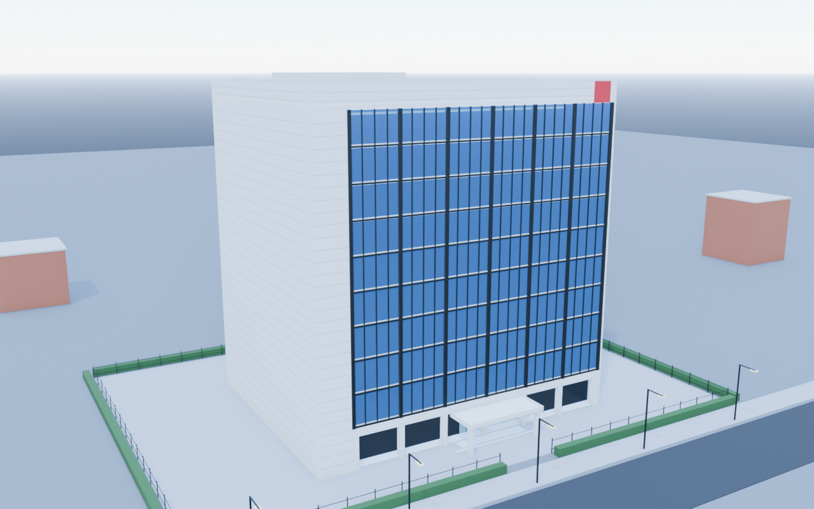
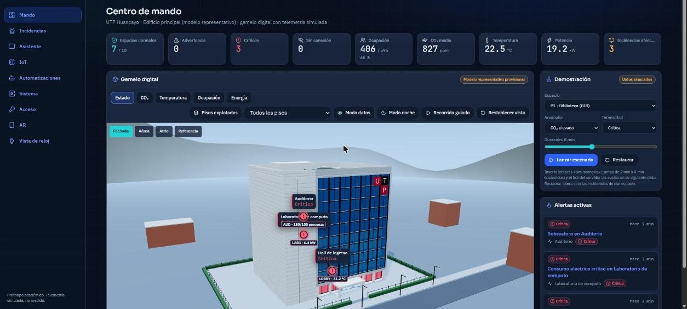
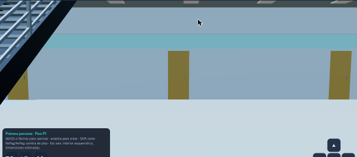
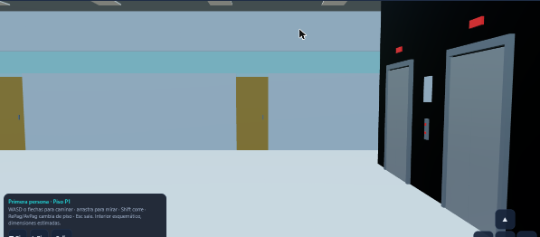
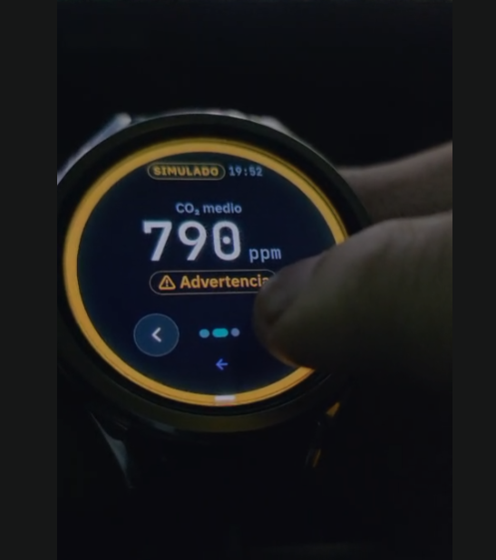
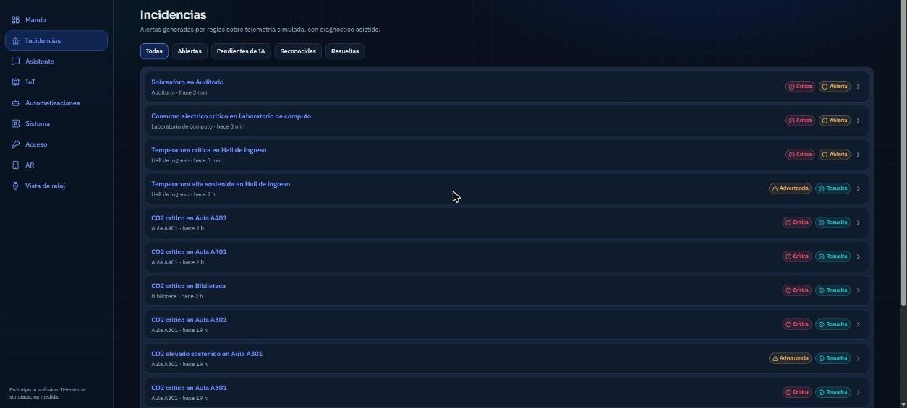
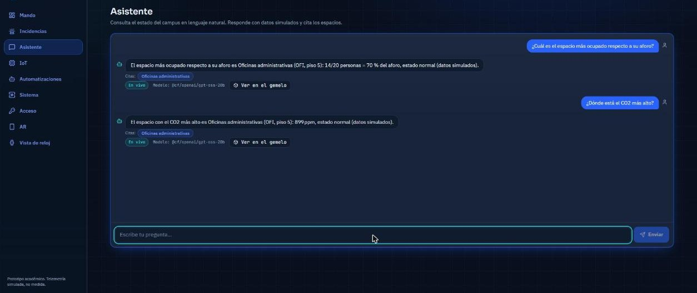
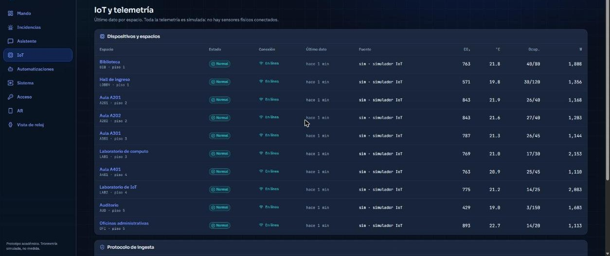

# CampusPulse 360

## Gemelo digital inteligente de la UTP Huancayo con IoT simulado, automatización RPA, IA generativa, DevOps y experiencia inmersiva web

**Informe técnico — Proyecto Final (Unidad 5) y Tarea Académica N.° 5**

| Dato | Valor |
|---|---|
| Universidad | Universidad Tecnológica del Perú — sede Huancayo |
| Curso | **[COMPLETAR: nombre del curso y sección]** |
| Docente | **[COMPLETAR: nombre del docente]** |
| Grupo | **[COMPLETAR: número de grupo]** |
| Integrante 1 | **[COMPLETAR: apellidos, nombres y código]** — rol: backend, IoT, RPA, IA y DevOps |
| Integrante 2 | **[COMPLETAR: apellidos, nombres y código]** — rol: gemelo 3D, interfaz, inmersión (AR / primera persona) y documentación |
| Fecha | 27 de noviembre de 2026 |
| Demo pública | https://campuspulse.campuspulse-api.workers.dev |
| Repositorio | https://github.com/Jhosep20-code/CampusPulse360 (rama `feature/hito-2`, PR #1) |

> **Alcance y honestidad del documento:**
> - **Sensores:** telemetría **simulada**, no hay sensores físicos.
> - **Modelo 3D:** **aproximado**; las medidas se estimaron con fotografías, sin planos oficiales.
> - **IA:** se usa **Cloudflare Workers AI con `@cf/openai/gpt-oss-20b`**, un modelo de pesos abiertos de OpenAI. **No es la API oficial de OpenAI**.
> - **TA5:** se resuelve con una alternativa inmersiva **web**. **No hay proyecto Unity.**
> - **Evidencias:** toda cifra procede de ejecuciones registradas en `docs/evidencias/`. Lo pendiente se declara como tal.
> - **Versiones:** se separa lo publicado en producción de lo que solo está en la rama (§11).

---

## Resumen ejecutivo
CampusPulse 360 es un gemelo digital de la sede UTP Huancayo, desplegado públicamente en Cloudflare con **costo adicional S/ 0,00**.

Cadena de funcionamiento:
1. Diez sensores **simulados** envían CO₂, temperatura, humedad, ocupación y consumo eléctrico.
2. Una API firmada (HMAC) guarda las lecturas en D1.
3. Un **bot RPA** se ejecuta cada minuto, evalúa **7 reglas sostenidas**, abre una única incidencia por condición y solicita un **diagnóstico con IA** (gpt-oss-20b en Workers AI). Si la IA falla, usa un respaldo por reglas rotulado «sin IA».
4. El **gemelo 3D de 10 pisos** (modelo de Blender 5.3 visualizado con Three.js) colorea el espacio afectado, muestra una baliza con el valor, ilumina su ventana en la fachada y enfoca la cámara.

Funciones adicionales:
- un **asistente conversacional** cuyos rankings y porcentajes calcula el backend;
- **AR WebXR**;
- un **recorrido cinematográfico guiado**;
- una **vista de reloj**;
- **acceso con passkeys**;
- **CI/CD** con GitHub Actions y Docker.

Para la TA5 se añadió un **recorrido en primera persona** con colisiones sobre el mismo modelo.

**Resultados verificados el 24-nov-2026:**

| Ámbito | Resultado |
|---|---|
| Escenarios en producción | 4 escenarios controlados abrieron la incidencia **crítica** esperada (CO₂ en A401; temperatura en el Hall con la nueva regla crítica; sobreaforo en el Auditorio; consumo en LAB1) |
| Diagnósticos | **3 en vivo** con gpt-oss-20b (1,7–4,0 s) y **1 por respaldo de reglas**, rotulado «sin IA» |
| Pruebas automáticas | **350 pruebas** unitarias y de integración en verde y **15 e2e** en Docker (3 omitidas a propósito) |
| CI | En verde en GitHub |
| Primera persona | **109 FPS** en el navegador visible |

**Pendiente:**
- validar la AR en el Galaxy S25 Ultra con la versión final;
- grabar el video;
- completar los datos académicos;
- autorizar el despliegue de la primera persona.

---

## 1. Problema y justificación
La gestión de las condiciones de un campus universitario suele ser **reactiva y fragmentada**:
1. Las anomalías de calidad del aire (CO₂), temperatura, aforo y consumo eléctrico se detectan tarde y se reportan manualmente.
2. No existe una vista unificada del estado de cada aula y cada piso.
3. Quien decide no puede preguntar «¿qué está pasando?» y obtener una respuesta respaldada por datos.

**Justificación:**
- La ventilación y el aforo de las aulas son criterios de salud y de calidad del servicio educativo.
- Los gemelos digitales, el IoT y la IA generativa ya son accesibles con planes gratuitos en la nube.
- Un prototipo integrado demuestra cómo detectar, explicar y comunicar estas situaciones en minutos y sin infraestructura propia.

> **[COMPLETAR, opcional]:** dato institucional con su fuente (número de aulas o aforo de la sede). No se incluyen estadísticas sin fuente verificable.

## 2. Objetivos
**Objetivo general:** diseñar, implementar y desplegar un gemelo digital de la UTP Huancayo que monitoree el estado de los espacios, automatice la detección y el diagnóstico de incidencias y permita explorar el edificio en 3D, en AR y en primera persona.

| Objetivo específico | Indicador | Resultado real (evidencia) |
|---|---|---|
| **OE1 IoT:** recibir y visualizar telemetría | 10 dispositivos × 5 variables, cada minuto | **Logrado:** • 10 × 5 en producción; • ingesta HMAC con 910/910 lecturas aceptadas; • simulador en la nube cada minuto (hito-3; Fig. «Telemetría») |
| **OE2 RPA:** gestionar incidencias sin intervención | Una incidencia por condición sostenida; cierre automático | **Logrado:** • bot cada minuto en `success`; • 7 reglas; • deduplicación; • cierre tras 10 min normalizados; • incidencias en A301, A401, BIB, LOBBY, LAB1 y AUD (hito-3, hito-10; §10) |
| **OE3 IA:** diagnóstico y respuestas útiles con datos reales | JSON válido con causa, acciones y evidencia; rankings correctos | **Logrado:** • 4 diagnósticos en vivo verificados (A401, LOBBY y AUD el 24-nov, A301 el 22-nov); • asistente contrastado con `/live` en 20 preguntas (hito-9, hito-10) |
| **OE4 DevOps:** probar y construir automáticamente | Pipeline con pruebas, e2e en Docker y secretos | **Logrado:** GitHub Actions en verde (gitleaks, tipos, pruebas, build, e2e con Docker Compose + Playwright, imagen del simulador) |
| **OE5 Experiencia:** 3D fluido, multidispositivo e inmersivo | ≥ 30 FPS en escritorio; móvil; AR | **Parcial:** • 113 FPS en el recorrido y 109 FPS en primera persona (escritorio con GPU); • vista móvil verificada en navegador; • **la AR física solo tiene una prueba anterior sin captura** (§7.6) |
| **OE6 Predicción:** pronóstico a 30 min | Error medido | **Logrado en pruebas:** Holt con backtest MAE sobre datos simulados |

## 3. Alcance y metodología
**Incluido:**
- **Edificio:** 10 pisos, con 10 espacios instrumentados en P1–P5:
  - P1: hall y biblioteca;
  - P2: aulas A201 y A202;
  - P3: aula A301 y laboratorio de cómputo;
  - P4: aula A401 y laboratorio de IoT;
  - P5: auditorio y oficinas.
- **Pisos P6–P10:** modelados y rotulados «sin espacios instrumentados».
- **Lógica:** 7 reglas, bot RPA, asistente de IA de solo lectura y escenarios de demostración.
- **Experiencia:** tres niveles de AR, vista de reloj y recorridos guiado y en primera persona.

**Excluido:** sensores físicos, planos oficiales, VR con visor, Unity y la API oficial de OpenAI.

**Metodología:** iterativa por hitos (hito-1 a hito-10), con verificación antes de cerrar cada módulo:
1. Análisis de las rúbricas (`docs/requisitos/`).
2. Decisiones registradas (`docs/decisiones/ADR-001…005`).
3. Implementación con pruebas automáticas.
4. Despliegue con respaldo de D1 y opción de rollback.
5. Evidencias fechadas (`docs/evidencias/`).

**Prácticas de trabajo:**
- control de versiones con PR #1, sin fusión automática a `main`;
- CI en cada push;
- Docker Compose para el entorno local y de contingencia.

## 4. Arquitectura y flujo de datos

**Decisiones de arquitectura:**
- **ADR-001:** Workers, D1 y Workers AI en el plan Free; agregaciones en SQL para respetar el límite de CPU.
- **ADR-002:** proveedor de IA intercambiable (Workers AI, adaptador para la API oficial de OpenAI sin activar y respaldo por reglas).
- **ADR-003:** passkeys sin contraseñas.
- **ADR-005:** alternativa web para la TA5.

**Organización del monorepo (pnpm):**

| Módulo | Contenido |
|---|---|
| `apps/api` | Hono, D1, bots e IA |
| `apps/web` | React 19 y Three.js/R3F |
| `packages/contracts` | Contratos zod compartidos |
| `tools/simulator` | Simulador IoT e imagen Docker |
| `tools/e2e` | Pruebas Playwright |
| `assets/3d/blender` | Modelo reproducible por script |
| `infra/` | Docker Compose |

## 5. Tecnologías utilizadas y justificación
| Eje del curso | Tecnología | Justificación |
|---|---|---|
| IoT | Simulador TypeScript con perfiles por tipo de espacio y hora de Lima; HTTPS con HMAC-SHA256 y anti-replay de ±60 s | El mismo protocolo admitiría un ESP32 real sin cambiar la API |
| RPA / bots | Cron Triggers: bot de incidencias por minuto y bot de reportes diario | Automatización sin servidores propios, auditada en `bot_runs` |
| IA generativa | Workers AI `@cf/openai/gpt-oss-20b`; prompts versionados; salidas JSON validadas con zod | Gratuito (10.000 neuronas al día), con function calling |
| CI/CD y contenedores | GitHub Actions; Docker (simulador, stack local, e2e con Compose, imagen en GHCR) | Pruebas automáticas en cada push; entorno reproducible sin conexión |
| Inmersión | Blender 5.3 → GLB; Three.js / React Three Fiber; WebXR; Scene Viewer; primera persona | Multiplataforma y sin instalación; un mismo modelo para todo |
| Interfaz | React 19, TypeScript, Tailwind; identidad visual #080F1D / #17243A / #2962FF / #22D3D6 / #F0B95B | Responsive de 360 a 1920 px, accesible, con vista de reloj circular |
| Datos | Cloudflare D1 (SQLite) | 100.000 escrituras al día gratis; uso medido de ~21 % |
| Seguridad | Passkeys (WebAuthn), roles, CSRF, CSP/HSTS, límite de solicitudes, gitleaks | Sin contraseñas almacenadas ni registro público |

## 6. Implementación y funcionamiento
### 6.1 IoT simulado
- **Dispositivos:** 10 (`DEV_<piso>_<código>`), uno por espacio, con 5 variables: CO₂, temperatura, humedad, ocupación y potencia.
- **Simulador:**
  - curvas de ocupación por tipo de espacio y hora;
  - CO₂ por balance de masa sencillo;
  - temperatura dependiente de la ocupación y del día;
  - ruido aleatorio.
  - Funciona en Docker (local) y en la nube (cada minuto).
- **Ingesta:** `POST /api/v1/ingest` con lotes firmados por gateway y ventana de ±60 s. Las firmas inválidas reciben **401**, verificado en producción el 24-nov.
- **Escenarios de demostración** (solo administrador):
  - CO₂, temperatura, sobreaforo, consumo o **sin conexión**, en advertencia o crítica, en cualquiera de los 10 espacios;
  - generan una rampa de lecturas `sim-scenario`;
  - **Restaurar** cierra solo las incidencias del espacio.

### 6.2 API y datos
- **API:** Hono en Workers (`/api/v1`), validación zod con contratos compartidos y errores RFC 7807.
- **D1:** migraciones **0001–0007**, todas aditivas. Antes de aplicar la 0006 y la 0007 se respaldó D1 (exportación con SHA-256 y Time Travel) y se ensayó la migración sobre una copia.
- **Estado en vivo:** el frontend consulta `/live` cada 10 s (con ETag) y deja de hacerlo con la pestaña oculta.

### 6.3 Reglas y automatización RPA
| Regla | Condición | Severidad |
|---|---|---|
| CO₂ elevado / CO₂ crítico | ≥ 1.200 ppm 120 s / ≥ 1.500 ppm 60 s | advertencia / crítica |
| Temperatura alta / crítica | ≥ 28 °C 180 s / ≥ 30 °C 60 s (`RULE_TEMP_CRIT`, migración 0007) | advertencia / crítica |
| Sobreaforo | ≥ 100 % del aforo durante 60 s | crítica |
| Consumo elevado / crítico | ≥ 4.500 W 120 s / ≥ 6.000 W 60 s | advertencia / crítica |

**Ciclo del bot** (cada minuto):
1. Detecta las condiciones sostenidas en SQL.
2. Abre **una** incidencia por espacio y regla. La regla crítica suprime la de advertencia de la misma métrica.
3. Diagnostica una incidencia por ciclo.
4. Cierra las que llevan 10 min normalizadas.
5. Registra la ejecución en `bot_runs` (por ejemplo, «reglas=7; nuevas=0»).

**Coherencia gemelo–incidencia:**
- El 24-nov se detectó que una temperatura de 31,2 °C se veía «crítica» en el gemelo pero abría una incidencia de advertencia.
- **Corrección:** `RULE_TEMP_CRIT`.
- **Verificación en producción:** la incidencia del Hall fue **crítica**.
- **Prueba de coherencia:** recorre 4 tipos × 2 intensidades en 3 espacios.

### 6.4 IA generativa y prompt engineering
**Tarea clave: diagnóstico de incidencias** (prompt `diagnose@1.0.0`):
- rol de operador de facilities;
- contexto con las lecturas de 30 min, la regla, el aforo y el historial;
- 2 ejemplos (*few-shot*);
- salida JSON `{causa_probable, severidad, acciones[], evidencia[], confianza}` validada con zod, con un reintento;
- regla «si el dato no está en el contexto, dilo».

**Asistente** (prompt `assistant@1.1.0`):
- **Herramientas** de solo lectura (nunca SQL libre).
- **Cálculos en el backend:** en 18 familias de preguntas, el backend elige la herramienta y calcula rankings y porcentajes; la IA redacta.
- **Validación de fidelidad:** una respuesta que omite el espacio o la cifra calculada se descarta y se usa el resultado verificado, rotulado `fallback`.
- **Defecto corregido:** «el espacio más ocupado respecto a su aforo» respondía «no hay» (hito-9).

**Diagnósticos verificados en producción:**

| Incidencia | Proveedor y modelo | Modo | Latencia |
|---|---|---|---|
| CO₂ crítico en A401 (24-nov) | workers-ai · @cf/openai/gpt-oss-20b | **en vivo** | 2.092 ms |
| Temperatura crítica en el Hall (24-nov) | workers-ai · @cf/openai/gpt-oss-20b | **en vivo** | 3.971 ms |
| Sobreaforo en el Auditorio, 180/150 (24-nov) | workers-ai · @cf/openai/gpt-oss-20b | **en vivo** | 1.696 ms |
| Consumo crítico en LAB1, 6.400 W (24-nov) | rules-fallback · rules-v1 | **respaldo (sin IA)** | — |

- **Fallo en LAB1:** la llamada a Workers AI devolvió una respuesta vacía. El sistema la registró (`valid_json = 0`) y aplicó el respaldo por reglas, **rotulado «sin IA» en la interfaz**. No se presenta como respuesta de IA.
- **Mejora en la rama:** el respaldo para consumo eléctrico ahora da una causa y 3 acciones concretas (antes: «sin pauta específica»). Aún no está en producción (§11).

**Cuota y proveedor:**
- límite propio de 250 llamadas al día;
- consumo del 24-nov: 48 llamadas y unas 874 neuronas de 10.000;
- `gpt-oss-20b` es de OpenAI, pero **servido por Cloudflare: no es la API oficial de OpenAI**. Existe un adaptador oficial (probado con mocks) que no está activado.

### 6.5 CI/CD y contenedores
- **Pipeline:** `.github/workflows/ci.yml`:
  1. gitleaks;
  2. tipos, pruebas y build;
  3. e2e con Docker Compose + Playwright;
  4. imagen del simulador en GHCR;
  5. deploy a Cloudflare, condicionado a `main` y a `DEPLOY_ENABLED`, **desactivado por diseño**.
- **Despliegue a producción:** manual y controlado. Se respalda D1, se audita la migración, se despliega con `wrangler deploy` desde el commit aprobado y se deja anotado el rollback.
- **Docker Compose local:** API (Worker + D1 local), cron y simulador. Es el entorno de contingencia sin internet; sin acceso a Workers AI, la IA cae al respaldo rotulado.

## 7. Gemelo 3D, inmersión web y TA5
### 7.1 Modelo arquitectónico (Blender 5.3)
- **Script reproducible:** `assets/3d/blender/build_utp_huancayo.py`.
  - Jerarquía `FACADE / ATRIUM / STAIRS / ELEVATORS / FLOOR_P01–P10 / SPC_*`.
  - Materiales PBR.
  - Exporta GLB para escritorio, móvil y AR.
- **Elementos:**
  - fachada con muro cortina y marca UTP iluminada de noche;
  - atrio con escaleras en zigzag;
  - núcleo de 3 ascensores;
  - aulas con mobiliario.
- **Medidas:** estimadas a partir de fotografías y videos (sin planos).

### 7.2 Visor 3D y alertas
- **Vistas:** Fachada, Aérea, Atrio (corte), Referencia (comparación con foto local), pisos explotados, aislamiento P1–P10, modo datos y modo noche.
- **Capas de datos:** estado, CO₂, temperatura, ocupación y energía.
- **Respuesta a una alerta:**
  - cambio de color y pulso en crítico;
  - **baliza con el valor**;
  - **ventana iluminada en la fachada**;
  - enfoque de cámara;
  - restauración al estado normal.
- **Localización:** el 24-nov, tres anomalías simultáneas solo colorearon sus 3 espacios; el resto siguió normal (KPI «7/10 normales, 3 críticos»).
- **Rendimiento con GPU:** 43 draw calls en la fachada, **113 FPS** de media en el recorrido y 117 en reposo.

### 7.3 Recorrido cinematográfico guiado
- **Recorrido:** aérea → fachada → atrio → piso → aula, con movimiento continuo de cámara.
- **Controles:** pausa, reinicio y cancelación (al arrastrar la cámara o con «Salir»).
- **Indicador ilustrativo de ascensor:** el GLB no tiene cabinas.
- **Verificado en producción (24-nov):** pausa sostenida 9 s, reinicio al paso 1 y cancelación.
- **Grabación real:** 55 s, con movimiento en el 87 % de las muestras.

### 7.4 Recorrido en primera persona (TA5)
| Aspecto | Implementación |
|---|---|
| Control | **WASD / flechas**, **Shift** para correr, **arrastrar con ratón o dedo** para mirar, **cruceta táctil** en móvil |
| Altura | Ojos a 1,65 m sobre la losa |
| Colisiones | Rectángulos en planta con las **mismas medidas del script de Blender**: muros exteriores, vacío del atrio (desde P2), escaleras, núcleo de ascensores y tabiques de los ambientes, **con 5 puertas como único paso** |
| Pisos | **P1–P10 mediante controles** (RePag/AvPag o botones). **Las escaleras no se recorren físicamente** |
| Salida | Esc o «Salir»: vuelven las cámaras orbitales y el Centro de mando; se cancela el recorrido guiado |
| Limitaciones | El mobiliario no colisiona; interior esquemático |

**Verificación (24-nov, build de producción en Docker, navegador visible):**
- **Rendimiento:** **109 FPS**.
- **Movimiento y colisiones:**
  - caminando con W se cruza la puerta central del hall hacia el pasillo;
  - el núcleo de ascensores detiene el desplazamiento lateral;
  - a 3,6 m de una puerta, el tabique detiene el avance.
- **Pisos:** el cambio se detiene en P10.
- **Salida:** Esc devuelve la vista orbital.
- **Errores:** ninguno en la consola.
- **Pruebas:** 7 pruebas unitarias de colisiones.
- **Móvil:** los controles quedaron dentro del lienzo y accesibles.

**Estado:** en la rama y en el stack local. **No está desplegado en producción** (§11).

### 7.5 Realidad aumentada
**Niveles de `/ar`:**
- **A:** WebXR `immersive-ar` con hit-test, maqueta de unos 0,60 m y colores en vivo;
- **B:** Scene Viewer de ARCore con el GLB de AR, estático;
- **C:** vista 3D, que **no es AR**.

**Evidencia:**
- en producción la página ofrece los tres niveles y, en escritorio, indica correctamente que no hay WebXR;
- el código de AR **no ha cambiado** desde la versión desplegada el 23-nov (`207d3808`);
- el equipo reportó una prueba física en el S25 Ultra, **pero no hay capturas de esa prueba en los archivos del proyecto**.

**Pendiente:** validar y capturar la AR con la versión final.

### 7.6 Vista de reloj
- **`/reloj`:** esfera circular con la alerta más grave, CO₂ medio, ocupación y la etiqueta SIMULADO.
- **Evidencia física:** fotografías del **Galaxy Watch6 Classic** del 23-nov a las 19:52 (versión `207d3808`), con «Campus normal» y «CO₂ medio 790 ppm». El código del reloj no ha cambiado desde entonces.
- **Telegram:** **no está configurado**. No hay notificaciones al reloj; es integración futura.

## 8. Adaptación técnica de la TA5
### 8.1 Qué pide la TA5 y qué se entrega
- **Lo que pide:**
  - un proyecto **Unity** 3D con terreno, objetos, materiales, duplicación y cámara FPS;
  - un proyecto VR en **Unity** con **Meta XR SDK, OpenXR y XR Plug-in Management**, ejecutado en un **simulador VR**.
- **Lo que entrega el equipo** (ADR-005):
  - escenario modelado en **Blender 5.3**;
  - visualización con **Three.js / React Three Fiber**;
  - recorrido cinematográfico;
  - recorrido **FPS web** con colisiones;
  - **AR WebXR** y **Scene Viewer**.
  - Todo integrado en la misma aplicación del Proyecto Final.

### 8.2 Comparación
| Aspecto | Unity + XR (lo que pide la consigna) | Alternativa web (lo entregado) |
|---|---|---|
| Herramientas | Editor Unity, C#, Meta XR SDK, OpenXR, XR Plug-in Management | Blender (modelo por script) → GLB → Three.js/R3F; un build web |
| Navegación | CharacterController, XR Origin y locomoción | FPS propio (teclado, ratón, táctil), colisiones en planta, cambio de piso por controles; además, cámaras, recorrido guiado y aislamiento de pisos |
| Compatibilidad | Ejecutable por plataforma; instalación previa | Navegador con WebGL 2, sin instalación. Probado en Chrome de escritorio y en vista móvil; **iOS no probado** |
| IoT e IA | Clientes HTTP a programar | Nativo: `/live`, incidencias, diagnósticos y asistente en el mismo gemelo |
| Realidad aumentada | AR Foundation, en otro proyecto | WebXR (A), Scene Viewer (B) y respaldo 3D (C) |
| Hardware | PC con GPU; visor para VR real | Navegador con WebGL 2; 109–117 FPS medidos en la laptop con GPU |
| Escalabilidad | Distribución por build | Despliegue global en el borde, actualización inmediata y CI/CD |
| Limitaciones | Curva de aprendizaje, licencias, integración manual de datos | **Sin VR con visor ni simulador VR**; colisiones simplificadas; interior esquemático |

### 8.3 Criterio por criterio
| Criterio TA5 | Equivalente técnico entregado | ¿Cumplimiento literal? |
|---|---|---|
| 1. Escenario 3D **en Unity** | Edificio de 10 pisos, entorno (terreno, calles, edificios vecinos) e interiores en Blender | **No** (herramienta distinta) |
| 2. Materiales y objetos 3D | PBR en todos los objetos; elementos duplicados e instanciados | Funcionalmente sí (en Blender) |
| 3. Recorrido tipo FPS | FPS web con control total y colisiones | Funcionalmente sí (**no en Unity**) |
| 4. Entorno VR **en Unity** | AR WebXR y FPS en pantalla | **No** |
| 5. Plugins **de Unity** | WebXR Device API, Three.js/R3F, drei | **No** |
| 6. Navegar el recorrido **VR** en simulador | FPS navegable en pantalla; AR en el móvil | **No** (sin simulador ni visor VR) |
| 7–10. Informe, capturas, código, redacción | Este informe, capturas clasificadas, monorepo con pruebas | Sí (pendientes los datos académicos) |

### 8.4 Procedimiento futuro: GLB → Unity + OpenXR
1. Instalar Unity 6 LTS con la plantilla «VR Core».
2. Añadir **glTFast** e importar `apps/web/public/models/utp-huancayo.glb`, que conserva la jerarquía `FLOOR_Pxx` / `SPC_*`.
3. En **XR Plug-in Management**, activar **OpenXR**. Añadir **XR Interaction Toolkit** y un **XR Origin** con locomoción continua y teletransporte.
4. Crear `BoxCollider` con las mismas medidas de `apps/web/src/twin/fps.ts` (muros, atrio, núcleo y tabiques con puertas).
5. Probar con el **XR Device Simulator** (sin visor) y, si se requiere, con **Meta XR SDK**.
6. Opcional: consultar `GET /api/v1/live` desde C# para colorear los `SPC_*`.

### 8.5 Defensa breve para la sustentación
> «La TA5 busca el diseño de un escenario 3D, un recorrido en primera persona y una experiencia inmersiva. Las implementamos sobre el **mismo gemelo digital** del Proyecto Final:
> - un modelo de Blender de 10 pisos;
> - un recorrido FPS con colisiones;
> - un recorrido guiado y AR WebXR en el teléfono.
>
> Elegimos la web porque funciona sin instalación en cualquier dispositivo, está desplegada públicamente y muestra en tiempo real los datos IoT, las incidencias y los diagnósticos de IA.
>
> Somos transparentes: **no hicimos un proyecto Unity ni usamos sus plugins de VR ni un simulador VR**; esos criterios no se cumplen literalmente. El modelo es GLB estándar y documentamos el procedimiento para llevarlo a Unity con OpenXR.»

## 9. Seguridad y costos
- **Acceso:**
  - **passkeys** (WebAuthn) sin contraseñas;
  - alta solo con token de un solo uso, ya consumido;
  - vinculación de dispositivos con un código de 10 min;
  - sesión en cookie httpOnly/Secure/SameSite=Strict de 8 h.
  - En producción: 1 administrador con 2 passkeys (escritorio y Android).
- **Autorización verificada en producción (24-nov):**
  - sin sesión, escenarios, restauración y reglas devuelven **401**;
  - una ingesta con firma inválida devuelve **401**;
  - un `Origin` ajeno recibe **403**;
  - el visitante tiene solo lectura.
  - Las operaciones administrativas se hicieron con una sesión de administrador válida.
- **Cabeceras:** CSP estricta, `nosniff`, `X-Frame-Options: DENY` y HSTS.
- **Secretos:**
  - solo en `wrangler secret` y en GitHub Secrets;
  - gitleaks sin hallazgos en el historial;
  - `.gitignore` excluye `.dev.vars`, `*.local.env`, `infra/*.secrets.local*` y `backups/`;
  - las capturas públicas tienen recortado el nombre del usuario.
- **Privacidad:** solo conteos agregados, sin cámaras ni identidades (Ley N.° 29733).
- **Costos: S/ 0,00.** Workers, D1 y Workers AI en plan Free, sin facturación. Al agotarse la cuota de IA, el sistema responde con reglas rotuladas.

## 10. Pruebas y resultados
| Tipo | Resultado | Fecha |
|---|---|---|
| Unitarias e integración | **350 aprobadas, 0 fallidas**: • contratos 9; • API 140; • web 191; • simulador 10 | 24-nov (local) |
| e2e Playwright + Docker Compose | **15 aprobadas, 0 fallidas, 3 omitidas a propósito** (5,5 min) | 24-nov (local) |
| CI en GitHub | En verde en `513ce1e`, `72a68a2` y `e682243`; el HEAD final se verifica en la PR #1 | 24-nov |
| gitleaks | Sin hallazgos en el historial de la rama | 24-nov |
| Asistente con el modelo real | 20 preguntas (12 en local y 8 en producción) contrastadas con `/live`: rankings por aforo y absolutos, CO₂, temperatura, consumo, sobreaforo, desconexión, incidencias y estado general | 24-nov |
| Escenarios en producción | 4 incidencias críticas coherentes con el estado del gemelo; 3 diagnósticos en vivo y 1 respaldo; las 3 de hoy restauradas (0 abiertas) | 24-nov |
| Primera persona | 109 FPS; puerta, núcleo, tabique, P10, Esc y móvil verificados | 24-nov (local) |
| Seguridad | 401 y 403 en operaciones sin autorización | 24-nov (producción) |

## 11. Estado de versiones: local, GitHub y producción
| Componente | Producción (Worker `d9180962`, commit `513ce1e`) | Rama `feature/hito-2` (GitHub) |
|---|---|---|
| Asistente corregido, gemelo, recorrido guiado, escenarios, AR, reloj, passkeys | **Sí** | Sí |
| Regla `RULE_TEMP_CRIT` (migración 0007 en D1) | **Sí** (D1 de producción) | Sí |
| Recorrido en primera persona | **No** (pendiente de autorización de despliegue) | Sí |
| Severidades en español en el panel Demostración | No | Sí |
| Respaldo por reglas específico para consumo eléctrico | No | Sí |

**Rollback disponible:**
- Worker: `npx wrangler rollback 207d3808-9c4e-4cad-9c9d-2e07fcb0aa91`;
- D1: marcador de Time Travel registrado en hito-10.

## 12. Matriz de cumplimiento
**Estados:**
- **CC:** cumplido y comprobado;
- **IE:** implementado, con evidencia insuficiente;
- **P:** parcial;
- **Pe:** pendiente;
- **NL:** no cumplido literalmente.

### 12.1 Proyecto Final (20 puntos)
| # | Requisito (máx.) | Implementación | Evidencia | Estado | Corrección necesaria |
|---|---|---|---|---|---|
| 1 | Problema relevante y objetivos medibles (2) | §1–2 con indicadores y resultados | Tabla de objetivos con fuentes | **CC** | Opcional: dato institucional con fuente |
| 2 | Integración articulada de 3 o más tecnologías (3) | IoT → API → D1 → RPA → IA → gemelo/AR, con CI/CD y Docker | Escenarios en producción (§10); figuras 1–2 | **CC** | — |
| 3 | Prototipo modular que resuelve el problema (3) | Monorepo, contratos, 7 migraciones, bots, escenarios, asistente | 350 pruebas, 15 e2e, producción operativa | **CC** | — |
| 4 | CI/CD y contenedores con automatización (3) | Actions (secretos, pruebas, e2e Docker, GHCR); Docker Compose | Runs en verde; salida de Docker Compose | **CC** | Deploy automático desactivado a propósito (manual con respaldo) |
| 5 | IA con prompts para una tarea clave (3) | Diagnóstico JSON + asistente con validación de fidelidad | 3 diagnósticos en vivo hoy; 20 preguntas verificadas | **CC**, con riesgo | **Riesgo:** «APIs de OpenAI» frente a Workers AI; confirmarlo con el docente |
| 6 | Interfaz intuitiva, fluida, en tiempo real (1,5) | SPA responsive, gemelo en vivo, FPS, AR, reloj | Capturas; 109–117 FPS; fotos del Watch6 | **IE** | Capturar la AR en el S25 con la versión final |
| 7 | Informe con esquemas, capturas, resultados e impacto (1,5) | Este informe (Word/PDF) | — | **P** | Completar los datos académicos (Anexo B) |
| 8 | Presentación con secuencia lógica y participación equitativa (1,5) | Guion de 5 min para 2 integrantes | `GUION_DEMO_5MIN.md` | **Pe** | Grabar el video y ensayar |
| 9 | Idea original que transforma la solución (1,5) | Gemelo conversacional (la IA mueve la cámara), alertas en la fachada, FPS sobre el gemelo vivo, escenarios configurables | Capturas y video del 23-nov | **CC** | — |

### 12.2 TA5 (20 puntos)
| # | Criterio | Equivalente entregado | Evidencia | Estado |
|---|---|---|---|---|
| 1 | Escenario 3D en Unity | Edificio y entorno en Blender | Renders, GLB | **NL** (equivalente funcional) |
| 2 | Materiales y objetos 3D | PBR y elementos instanciados | Renders | **CC** en Blender |
| 3 | Recorrido tipo FPS | FPS web con colisiones | 5 capturas, 7 pruebas, 109 FPS | **CC** en web, local (no en Unity ni en producción) |
| 4 | Entorno VR en Unity | — | — | **NL** |
| 5 | Plugins de Unity | Equivalentes web | — | **NL** |
| 6 | Ejecutar y navegar el recorrido VR | FPS en pantalla; AR en el móvil | Capturas FPS | **NL** |
| 7 | Informe técnico | Este informe | — | **P** (datos académicos) |
| 8 | Capturas y evidencias | `capturas/` clasificadas | Inventario | **CC** (falta la AR del S25) |
| 9 | Código limpio y organizado | Monorepo con módulos y pruebas | Repositorio | **CC** |
| 10 | Redacción técnica | Este informe | — | **CC** (revisión final del equipo) |

## 13. Limitaciones, riesgos y alternativas
| Limitación o riesgo | Impacto | Alternativa o mitigación |
|---|---|---|
| Sensores simulados | No se miden condiciones reales | Mismo protocolo HMAC para un ESP32 con sensor NDIR de CO₂ |
| Workers AI en lugar de la API oficial de OpenAI | Posible lectura estricta del criterio 5 | Adaptador oficial listo (requiere una clave propia; hoy no se activa por costo) |
| Fallo o cuota de IA (ocurrió en LAB1) | Diagnóstico sin IA | Respaldo determinista rotulado; mejora de pautas en la rama |
| Geometría aproximada sin planos | El interior no es fiel | Croquis del equipo y modelo regenerable por script |
| TA5 sin Unity ni VR con visor | Criterios 4–6 no literales | Procedimiento GLB → Unity/OpenXR (§8.4) |
| Primera persona sin desplegar | No visible en la URL pública | Despliegue controlado con respaldo y rollback, previa autorización |
| AR sin captura en la versión final | Evidencia débil del criterio 6 | Probarla y capturarla en el S25 antes de la sustentación |
| Wi-Fi de la sustentación | Demo en vivo interrumpida | Hotspot del S25, `docker compose up` sin internet y video de respaldo rotulado |
| Telegram no configurado | Sin avisos al reloj | Integración futura (token del bot) |

## 14. Conclusiones y recomendaciones
**Conclusiones (basadas en los resultados):**
1. **Cadena completa en producción:** CampusPulse 360 integra los cinco ejes del curso. El 24-nov, cuatro escenarios en espacios distintos (A401, Hall, LAB1 y Auditorio) generaron la incidencia crítica esperada en uno o dos ciclos del bot, con diagnóstico y reflejo en el gemelo, y volvieron al estado normal al restaurar.
2. **Cálculo determinista más IA:** combinar cálculo determinista en el backend con redacción por IA y validación de fidelidad eliminó las respuestas incorrectas del asistente. Ante un fallo real del modelo (LAB1), el sistema degradó de forma transparente a reglas rotuladas.
3. **Coherencia de reglas:** la prueba de coherencia entre el estado visual y la severidad detectó y permitió corregir una regla faltante (temperatura crítica), verificada luego en producción.
4. **TA5 en web:** la alternativa web cubre funcionalmente el escenario 3D y el recorrido en primera persona (109 FPS, colisiones con muros, tabiques, atrio y núcleo) dentro del mismo gemelo con datos en vivo. No sustituye literalmente a Unity ni a la VR con visor.
5. **Costo y entrega controlada:** el proyecto opera con S/ 0,00. Cada despliegue tuvo respaldo de datos, ensayo de migración y opción de rollback.

**Recomendaciones:**
1. Instalar un sensor físico de CO₂ por el mismo protocolo para validar el modelo con mediciones reales.
2. Configurar Telegram para las notificaciones al reloj.
3. Evaluar el adaptador de la API oficial de OpenAI si se dispone de una clave institucional.
4. Ampliar a unos 20 espacios instrumentados (2 por piso) con migraciones aditivas, dentro del plan gratuito.
5. Si la asignatura lo exige, llevar el GLB a Unity con OpenXR siguiendo el §8.4.

## 15. Referencias
- Cloudflare. (2026). *Workers platform limits* y *Pricing*. https://developers.cloudflare.com/workers/platform/limits/ (consultado el 21-nov-2026).
- Cloudflare. (2026). *D1 limits* y *pricing*. https://developers.cloudflare.com/d1/platform/limits/ (consultado el 21-nov-2026).
- Cloudflare. (2026). *Workers AI pricing* y *models: @cf/openai/gpt-oss-20b*. https://developers.cloudflare.com/workers-ai/ (consultado el 21-nov-2026).
- OpenAI. (2025). *gpt-oss: open-weight reasoning models*. https://openai.com/index/introducing-gpt-oss/
- W3C. (2025). *WebXR Device API*. https://www.w3.org/TR/webxr/
- W3C. (2021). *Web Authentication: An API for accessing Public Key Credentials, Level 2*. https://www.w3.org/TR/webauthn-2/
- three.js authors. (2026). *three.js documentation*. https://threejs.org/docs/
- Poimandres. (2026). *React Three Fiber* y *drei*. https://docs.pmnd.rs/
- Blender Foundation. (2026). *Blender 5.3 Reference Manual*. https://docs.blender.org/manual/
- Google. (2026). *ARCore supported devices* y *Scene Viewer*. https://developers.google.com/ar/devices
- GitHub. (2026). *GitHub Actions documentation*. https://docs.github.com/actions
- Docker Inc. (2026). *Docker Compose documentation*. https://docs.docker.com/compose/
- Unity Technologies. (2026). *XR Interaction Toolkit* y *OpenXR Plugin manuals*. https://docs.unity3d.com/ (referencia para el §8)
- Congreso de la República del Perú. (2011). *Ley N.° 29733, Ley de Protección de Datos Personales*.

## Anexo A. Evidencias
- **Inventario clasificado:** `INVENTARIO_EVIDENCIAS.md` (qué demuestra cada captura y dónde se usa).
- **Registros fechados:** `docs/evidencias/hito-1 … hito-10`.
- **Decisiones:** `docs/decisiones/ADR-001…005`.

## Anexo B. Datos que debe completar el equipo
1. Curso, sección, docente y número de grupo (portada).
2. Apellidos, nombres y código de los **2 integrantes** (portada).
3. Si ya se entregó la propuesta inicial (entregable 1).
4. Opcional: dato institucional con fuente (§1).

## Anexo C. Ejecución
- **Producción:** https://campuspulse.campuspulse-api.workers.dev
  - el visitante tiene solo lectura;
  - el administrador entra con passkey.
- **Local sin internet:** con Docker Desktop, en la raíz del repositorio, `docker compose up -d` y abrir http://localhost:8787. La IA cae al respaldo rotulado.
- **Desarrollo:** `pnpm install` → `pnpm -r typecheck` → `pnpm -r test` → `pnpm --filter @campuspulse/web build`; e2e con el stack de Docker levantado: `cd tools/e2e && npx playwright test`.
